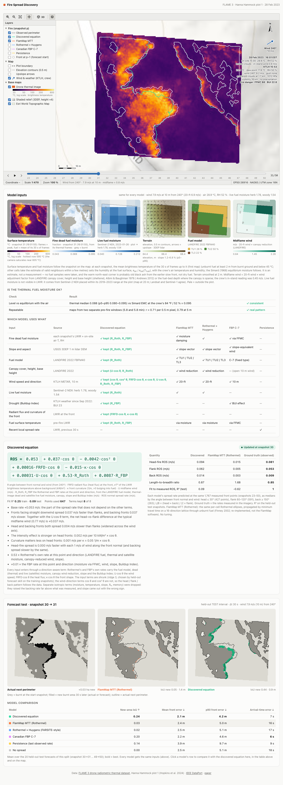

# Fire-spread law from drone LWIR: data-discovered vs. operational models

A reproducible pipeline and one self-contained interactive page (`web/index.html`) built on the **FLAME 3** drone radiometric thermal record of the **Hanna Hammock** prescribed burn. The burn is at Tall Timbers Research Station, Florida, on 28 Feb 2023, plot 1. The record has one 0.5 m frame every 5 s for 25 min over a ~100 × 90 m pine stand. A crew ignition line along the west edge at 15:57:55 EST launches a single head fire east across the plot.

The pipeline:

1. extracts the burnt area, the active front and the **rate of spread (ROS)** along the front normal, every 30 s (snapshots 23–50);
2. builds the **model inputs** every model receives:
   - fine dead fuel moisture estimated from the pre-fire thermal image (and checked against weather and satellites);
   - live fuel moisture from Sentinel-2, cross-checked with Landsat 8/9 and Sentinel-1 radar;
   - lidar terrain (slope, aspect);
   - LANDFIRE fuel models and canopy (wind reduction);
   - the airport wind, and the drought index (Buildup Index) computed from its weather;
3. forecasts each next snapshot with four operational or reference models:
   - **FlamMap** minimum travel time;
   - **FARSITE-style** Rothermel + Huygens wavelets;
   - **Canadian FBP** C-7;
   - **persistence**;
4. **discovers a spread equation** from the first 8 snapshots with sparse regression (STLSQ) over 15 candidate terms, including Rothermel's and FBP's own per-cell rates;
5. scores every model on the 20 held-out forecasts 30→31 … 49→50.



<sub>Basemap: Esri World Topographic Map — Sources: Esri, HERE, Garmin, Intermap, increment P Corp., GEBCO, USGS, FAO, NPS, NRCAN, GeoBase, IGN, Kadaster NL, Ordnance Survey, Esri Japan, METI, Esri China (Hong Kong), © OpenStreetMap contributors, and the GIS User Community.</sub>

**The page** (`web/index.html`, self-contained, works from `file://`):
- A map window laid out like desktop GIS software:
  - **Toolbar:** zoom in, zoom out, zoom to the plot, pan, and show/hide the Layers panel.
  - **Layers panel:** a docked layer tree with collapsible groups.
    - Fire: observed perimeter, each model's forecast perimeter, front at p−1.
    - Map: plot boundary, elevation contours, upslope arrows.
    - Base maps: the drone thermal image (with its °C legend) and the Esri World Topographic Map.
  - **Canvas:** the basemap streams as Esri tiles, reprojected on the fly to UTM 16N, so you can zoom out to the whole area (the embedded image around the plot works offline). Drawn on the map:
    - shaded relief (3DEP 3 m, height ×4, plus Esri World Hillshade farther out);
    - a segmented scale bar and a north arrow (true north);
    - a wind arrow with the weather at the snapshot time: the crew's on-site reading, the latest KTLH report (temperature, dew point, humidity, gusts, sky, pressure, visibility) and the day's FFMC / BUI.

    The mouse wheel zooms.
  - **3D view** (toolbar "3D"): a tilted relief model.
    - Terrain from USGS 3DEP (±450 m), coloured by elevation, shaded and printed with the topo map, with side walls.
    - The thermal image and fire perimeters of the current snapshot are draped on it.
    - Controls: left-drag rotates, right-drag pans, the wheel zooms, and "Height ×" sets the exaggeration.
    - The 3D engine (three.js r128) loads from cdnjs on first use, so it needs internet.
  - **Time controller:** previous, play/pause, next and the snapshot slider (23–50).
  - **Status bar:** coordinate, scale 1:N, zoom, wind and the coordinate system (EPSG:26916). Nothing pops up on hover.
- **Model inputs**:
  - six maps: surface temperature, dead fuel moisture, live fuel moisture, terrain, fuel model, midflame wind.
    - Surface temperature and dead fuel moisture follow the snapshot on the map.
    - The temperature map is on the thermal log scale (20–600 °C): flames at their 30 s peak, up to 595 °C (the camera saturates near 605 °C).
    - Burnt ground is grey on the moisture map.
  - two checks of the thermal moisture;
  - which model uses which input.
- **Discovered equation**: the equation, plain-language terms, and head / flank / back rates vs the measured ground truth.
- **Forecast test**: actual vs forecast panels and the model comparison table. Click a model's row to compare it with the discovered equation.

> **This is one 25-minute fire on one 1-hectare plot, not a validated spread model.** Read [Limitations](#limitations) before quoting a number.

## Results (train on snapshots 23–30, test on 30→31 … 49→50)

**Discovered equation.** Every input enters through a **direction-aware** term, one that speeds the head more than the back:
- Rothermel's and FBP's own per-cell rates (R_Roth, R_FBP) carry the fuel model, dead (thermal) and live (satellite) fuel moisture, the canopy wind reduction, slope and the Buildup Index.
- U·cos θ carries the midflame wind speed.
- FRFD·cos θ carries the heat flux at the front.
- κ·cos θ carries the front shape (curvature).

The input terms are shrunk by ridge regression, with the strength chosen by held-out forecast skill on the training snapshots. The wind-direction terms cos θ and cos² θ are not shrunk, so the head / flank / back pattern follows the data.

```
ROS [m/s] = 0.053 + 0.037·cos θ − 0.0042·cos² θ + 0.00016·FRFD·cos θ − 0.015·κ·cos θ
            + 0.00031·U·cos θ + 0.53·R_Roth + 0.0087·R_FBP
R² on measured ROS: 0.25 train (647 points), 0.09 test (1,120 points)
```

Every sign is physical:
- downwind and more intense fronts are faster;
- bulging heads are slower;
- more wind is faster;
- the Rothermel and FBP rates enter positively.

Separate isotropic terms for moisture, temperature, slope, R₀ and memory were dropped. They raised the backing rate far above what was measured (0.037 vs 0.009 m/s), and slope came out with the wrong sign: it is nearly collinear with the wind here (r = 0.89). Moisture, temperature and slope still enter through the Rothermel and FBP rates.

**Forecast skill**, mean over the 20 test forecasts. The p-value is a paired Wilcoxon signed-rank test of the per-snapshot new-area IoU against the discovered equation.

| Model | New-area IoU ↑ | Mean front error ↓ | p90 front error ↓ | Arrival-time error ↓ | p vs discovered |
|---|---|---|---|---|---|
| **Discovered equation** | **0.24** | **2.1 m** | **4.2 m** | 6.9 s | — |
| FlamMap MTT (Rothermel, LANDFIRE fuels) | 0.03 | 2.4 m | 5.0 m | 16 s | < 0.001 |
| Rothermel + Huygens (FARSITE-style) | 0.02 | 2.5 m | 5.1 m | 17 s | < 0.001 |
| Canadian FBP C-7 | 0.20 | 2.2 m | 4.6 m | **6.5 s** | 0.04 |
| Persistence (last observed local rate) | 0.14 | 3.9 m | 9.7 m | 9 s | < 0.001 |
| No spread | 0.00 | 2.5 m | 5.1 m | 18 s | < 0.001 |

**Spread rates at the 1,767 measured front points.** Values are medians of each model's predicted rate at the same points, grouped by the angle between the front normal and the wind.

| | Head (≤ 30°) | Flank (60–120°) | Back (≥ 150°) | L/B | R² test |
|---|---|---|---|---|---|
| Measured (ground truth) | 0.081 m/s | 0.053 | 0.009 | 0.85 | 1 |
| Discovered | 0.094 | 0.062 | 0.014 | 0.87 | 0.09 |
| Rothermel (FlamMap / FARSITE) | 0.015 | 0.005 | 0.003 | 1.68 | −0.62 |
| FBP C-7 | 0.293 | 0.069 | 0.003 | 2.15 | −1.59 |

Rothermel with the LANDFIRE fuel models (TU1 / TU2 / TL3) and the satellite live moisture under-predicts the head fire about 5×. FBP, fed the drier per-snapshot moisture, over-predicts it about 3.6× and makes the fire far too elongated. It still has the best arrival-time error, because it moves the fire fast enough in the right direction. The fire spread almost as fast on its flanks as at its head (measured L/B 0.85). Neither operational model reproduces that without tuning, and the models are deliberately not tuned.

### Ideas from WSTS+ (Lahrichi et al. 2025, arXiv:2502.12003) and what they changed

That paper is about deep-learning next-day fire masks rather than equation discovery. Three of its lessons transfer to this pipeline:

1. use the fire's **time history**;
2. feed **all drivers** (fuels, terrain, weather);
3. **select and test on the metric you care about**, with a significance test.

Each is implemented here and added one at a time (`data/interim/HH1/ablation.csv`, made by `evaluate.ablation`). The final configuration D was fixed before looking at test scores. This table is diagnostic.

| Variant | New-area IoU | Mean front error | p90 front error | Arrival error | R² test | Terms |
|---|---|---|---|---|---|---|
| A. front terms only (θ, FRFD, κ); sparse, λ by ROS error | 0.221 | 2.11 m | 4.31 m | 7.5 s | 0.04 | 3 |
| B. + every input as a candidate (16 terms); sparse, λ by forecast skill, sign priors | 0.237 | 2.12 m | 4.19 m | 6.3 s | 0.00 | 1–2 |
| C. all 16 terms kept, ridge by forecast skill | 0.244 | 2.94 m | 6.01 m | 6.1 s | −1.25 | 16 |
| **D. direction-aware library, all kept, inputs shrunk, cos θ / cos² θ free (final)** | **0.241** | **2.09 m** | 4.25 m | 6.9 s | **0.09** | 8 |

- **Sparse selection (B)** keeps almost nothing. On one short fire, extra terms mostly fit noise.
- **Keeping every raw input (C)** overshoots at hot spots: the front error rises to 2.9 m and the spread-rate R² goes strongly negative. Isotropic terms also make the backing fire far too fast.
- **The direction-aware library (D)** uses every input and keeps forecast skill. It matches the measured fire shape best: L/B 0.87 vs 0.85 measured, back rate 0.014 vs 0.009 m/s.
- **Memory:** the local rate is noisy at 0.5 m and 30 s. The previous interval's rate shares this snapshot's front position with the interval being forecast, so position noise makes the two anti-correlated (P uses the interval before that). Memory was not kept in the final library.

## Model inputs (same for every model that can use them)

| Input | Source | How |
|---|---|---|
| Fine dead (1-h) fuel moisture, fraction, **per snapshot** | FLAME 3 thermal frames + crew air T / RH (84 °F, 52 %) | See the steps below. Pre-fire range 0.080–0.095 (p5–p95); unburnt fuel reads drier as the plot warms during the burn. 10-h / 100-h = 1-h + 0.01 / + 0.02 |
| Slope, aspect | USGS 3DEP 1 m lidar DEM (FL Hurricane Michael 2020) | smoothed at 2 m; slope 1–7 % (p5–p95); a low knoll in the NE centre |
| Fuel model | LANDFIRE 2022 FBFM40, 30 m | TU1 28 %, TU2 50 %, TL3 22 % of the plot (Scott & Burgan 2005) |
| Canopy cover / height / base height | LANDFIRE 2022 | wind adjustment factor, explained below; median 0.11 |
| Wind | KTLH METAR (Tallahassee, 30 km S) | 7.9 m/s at 10 m from 240° → 20-ft 6.9 m/s (÷ 1.15) → midflame ≈ 0.8 m/s (median). The crew's in-stand reading was 0.45 m/s |
| Live fuel moisture | Sentinel-2 NDII (Landsat 8/9, Sentinel-1 cross-checks) | herb 1.78, woody 1.54 for the whole plot; see [Fuel moisture](#fuel-moisture-satellites-and-checks) |
| Drought (Buildup Index) | KTLH noon weather since Sep 2022 (FWI system) | BUI 22.8 → FBP buildup effect 0.76 |

The fuel-moisture estimate works in three steps:

1. Take each pixel's mean brightness temperature.
   - **Pre-fire map:** frames ≥ 2 min before the fire arrives and ≥ 5 m from burnt ground.
   - **Each snapshot:** the 30 s of frames up to that snapshot, using only unburnt fuel ≥ 2 m from burnt ground and below 45 °C. Other cells take the estimate of valid neighbours within a few metres.
   - Every forecast from snapshot i uses snapshot i's map (stored at 1 m).
2. Compute the humidity at the fuel surface as RH_fuel = e_air / e_sat(T_fuel).
3. Convert to fuel moisture with the Simard (1968) equilibrium moisture formula.

The wind adjustment factor is sheltered (Albini & Baughman 1979 / Andrews 2012) where the crown fill fraction CC × CR / 3 > 0.05. Elsewhere it is unsheltered, from the fuel-bed depth. The midflame wind is this factor times the 20-ft wind.

| | Discovered | FlamMap MTT | Rothermel + Huygens | FBP C-7 | Persistence |
|---|---|---|---|---|---|
| Fuel moisture | candidates M, R₀, R_Roth, R_FBP | ✓ damping | ✓ | ✓ FFMC | — |
| Slope / aspect | candidates S, R_Roth, R_FBP | ✓ slope vector | ✓ slope vector | ✓ slope-equivalent wind | — |
| Fuel model | candidates R₀, R_Roth | ✓ | ✓ | C-7 fixed | — |
| Canopy | candidates U·cos θ, R_Roth | ✓ wind reduction | ✓ wind reduction | — (open 10 m wind) | — |
| Live fuel moisture | candidates R₀, R_Roth | ✓ | ✓ | — | — |
| Buildup Index | candidate R_FBP | — | — | ✓ BUI effect | — |
| Wind | θ terms, U, R_Roth, R_FBP | ✓ 20-ft | ✓ 20-ft | ✓ 10 m | — |
| Front radiant flux, curvature | candidates FRFD, κ | — | — | — | — |
| Recent local spread rate | candidate P (30–60 s earlier) | — | — | — | ✓ (last 30 s) |

## Fuel moisture: satellites and checks

**Live fuel moisture.** The drone LWIR cannot see it.

- Every clear scene from 2019 to the day before the burn, over the plot's own pixels with cloud and shadow masked, gives a plot-mean index.
- The last pre-burn value is placed within the plot's own 2019–2023 range (5th–95th percentile), giving a position r.
- r is mapped linearly onto the NFDRS live-moisture limits (herbaceous 0.30–2.50, woody 0.60–2.00). This is the relative-greenness method of Burgan & Hartford (1993), with the water-sensitive NDII instead of NDVI.

| Sensor · index | Last pre-burn scene | Value | 2019–23 range (p5–p95) | r |
|---|---|---|---|---|
| **Sentinel-2 NDII (1.6 µm), used** | 26 Jan 2023 | 0.150 | −0.037 – 0.240 (191 scenes) | **0.67** |
| Sentinel-2 NDWI (2.2 µm) | 26 Jan 2023 | 0.449 | 0.159 – 0.545 | 0.75 |
| Landsat 8/9 NDII | 24 Jan 2023 | 0.145 | 0.015 – 0.259 (53 scenes) | 0.53 |
| Sentinel-1 VH backscatter | 16 Feb 2023 | −14.6 dB | −16.2 – −13.5 dB (120 scenes, one orbit) | 0.59 |
| Sentinel-2 NDII under thin cirrus (not used) | 20 Feb 2023 | 0.065 | | 0.37 |

- **Result:** herb **1.78**, woody **1.54** for the plot. Both Rothermel models use these (TU1 herb and woody, TU2 woody).
- **Why the latest optical scene is a month old:** every February Sentinel-2 and Landsat scene was cloudy or cirrus-covered over this 1 ha plot. The radar sees through cloud and puts 16 Feb at a similar position.
- **Caveat:** the satellites see the pine canopy and the understorey together, at 10–30 m. So one plot value is used, not the pixel pattern. This mapping makes the understorey wetter than the earlier dormant-season assumption (0.60 / 0.90), which slows Rothermel further.

**Is the thermal fuel moisture OK?** It is partly OK (`moisture.json`):

| Check | Result |
|---|---|
| Level vs equilibrium with the air | thermal median 0.088 (p5–p95 0.080–0.095) vs Simard EMC at the crew's 84 °F / 52 % = 0.095 ✓ |
| Level vs weather history | FFMC 88.0 from KTLH noon weather since Sep 2022 → 0.129. The thermal method assumes equilibrium (no time lag), so it reads **0.04 drier** ✗ |
| Repeatable | maps from two separate 5.8-min pre-fire windows: r = 0.71 per 0.5 m pixel, **0.79 at 5 m** ✓ |
| Moister under denser canopy? | Spearman ρ = −0.01 with LANDFIRE canopy cover ✗ (not seen at 30 m) |
| Agrees with Sentinel-2 NDII? | ρ = −0.04 over the 12 plot pixels of 20 m ✗ |
| Changes the forecasts? | test new-area IoU, uniform weather-based moisture → per-snapshot thermal maps: FlamMap 0.03 → 0.03, Rothermel 0.01 → 0.02, **FBP 0.10 → 0.20** |

**Verdict.**
- **What holds up:** the pattern is real and the level matches the air's equilibrium moisture.
- **What does not:** the level is about 0.04 drier than the weather-history estimate. Nothing at 20–30 m explains the pattern.
- **How to use it:** as a relative map with an absolute uncertainty of about ±0.05.
- **Where it matters:** it matters a lot for FBP, whose ISI is very sensitive to FFMC. It hardly matters for Rothermel, whose error is dominated by its slow head fire.
- Only fuel samples could settle the absolute level.

## Models

- **Rothermel, per cell.** Rothermel (1972) in the Albini (1976) form is evaluated with the cell's fuel model, moisture and midflame wind. The wind and slope factors are added as vectors (Rothermel 1972; as in FARSITE / FlamMap). The effective wind of the resultant gives the Anderson (1983) L/B. This yields one elliptical wavelet per 0.5 m cell.
  - **FARSITE-style:** each front point and ignition grows the wavelet of its own cell (Huygens / Wulff construction).
  - **FlamMap MTT** (Finney 2002, re-implemented, *not* the FlamMap software): Dijkstra on a 16-neighbour lattice through unburnt fuel. An edge takes half its length at the speed of the cell it leaves and half at the speed of the cell it enters.
- **FBP C-7, per cell** (ST-X-3).
  - FFMC comes from the moisture map; the buildup effect comes from the BUI of the weather run.
  - The 10 m open wind is added as a vector to the slope-equivalent wind (eqs. 39–48), giving WSV and RAZ.
  - From those: ISI, head and back rates, and L/B.
- **Persistence:** each front point keeps the rate measured near it in the previous 30 s (isotropic). No inputs, no fitting.
- **Discovered:** STLSQ on standardised terms (Brunton et al. 2016), with the following settings.
  - **Library:** `1, cos θ, sin θ, cos² θ, FRFD, FRFD·cos θ, κ, κ·cos θ, M, S, U·cos θ, R₀, P, R_Roth, R_FBP`.
    - R_Roth and R_FBP are the normal spread rates of the per-cell Rothermel and FBP ellipses at the front point and direction: every input passed through each model's own physics.
  - **Sign priors:** S, U·cos θ, R₀, P, R_Roth and R_FBP ≥ 0; M ≤ 0.
  - `Config.forced_terms` can force terms in (exempt from the threshold). The ablation (E, F) shows this hurts here, so nothing is forced.
  - **λ:** leave-one-interval-out over the training snapshots, scored by new-area IoU of the forecasts, then a paired 1-SE rule.
  - **Uncertainty:** block bootstrap (interval × 15 m tile) for inclusion rates.
- Every model gets the same front and the same ignitions detected in the imagery. Every model's normal speed is capped at 1 m/s.

**Metrics.**
- New-area IoU (overlap of predicted and actual newly burnt area).
- Mean and p90 distance between the predicted and actual fronts.
- Arrival-time error, censoring-aware.

## Quick start

Data and the built page are not in the repository. `python run_all.py` downloads only what it needs (FLAME 3 members by HTTP range, KTLH weather, USGS 3DEP, LANDFIRE, Sentinel-2 / Landsat / Sentinel-1 over the plot, the Esri basemap) and writes `web/index.html`. QA figures from a full run are in `figures/`.


```bash
pip install -r requirements.txt     # Python >= 3.10
python run_all.py                   # download (FLAME 3 members by HTTP range, KTLH, 3DEP, LANDFIRE; cached) -> web/index.html
open web/index.html                 # self-contained, works from file://
```
- **Stages:** download → ingest → fronts → landscape → moisture (satellites, FWI, checks) → evaluate (+ ablation) → export → qa. Each stage is skipped when its outputs exist; use `--force landscape evaluate export` (or `--force all`) to redo stages.
- **Checks:**
  - `python -m pytest -q tests/` runs 20 unit tests:
    - Rothermel against Anderson's tables;
    - per-cell Rothermel / FBP against the scalar models, and slope vectors;
    - thermal moisture, canopy WAF;
    - FWI codes against Van Wagner & Pickett's (1985) test day, and live-moisture scaling;
    - MTT, STLSQ recovery, sign priors, forced terms and metrics.
  - `node tests/check_js_core.js` checks that the browser engine reproduces Python's coefficients and every model's per-snapshot metrics.
  - `python tests/check_web.py` is a headless-browser smoke test and saves screenshots to `data/qa/HH1/`. It needs Playwright.

```
pipeline/
  config.py      tunables: thresholds, split, term library, λ criterion, sign priors
  remote_zip.py  HTTP-range zip reader (pulls single members out of the 35 GB FLAME 3 archive)
  flame3.py      download, frame reprojection, 30 s snapshots, masks, ignitions, wind, fronts and ROS samples
  fronts.py      sub-pixel fronts, curvature, ROS along the normal
  landscape.py   model inputs: 3DEP DEM, LANDFIRE layers, canopy WAF, fuel moisture from the thermal image
  moisture.py    live fuel moisture (Sentinel-2, Landsat, Sentinel-1), FWI codes from KTLH weather, thermal-moisture checks
  physics.py     Rothermel (+ Scott & Burgan TU1/TU2/TL3), per-cell Rothermel and FBP fields, Anderson ellipse
  discover.py    term library, block normal equations, sign-constrained STLSQ, CV, bootstrap, explanations
  forecast.py    Huygens/Wulff and FlamMap-MTT forecast engines + metrics (mirrored in the page's JS)
  evaluate.py    one split: fit, forecasts, point-wise skill, Wilcoxon tests, ablation
  export.py      web/data/hanna_hammock.json + self-contained web/index.html
  sites.py       page text and data citations
  plots.py       QA figures (data/qa/HH1/)
  web_template.html   the page (HTML/CSS/JS; data inlined at build time)
```

## Data (please cite)

| Dataset | Used for |
|---|---|
| Hopkins, B.; O'Neill, L.; Marinaccio, M.; Rowell, E.; Parsons, R.; Flanary, S.; Nazim, I.; Seielstad, C.; Afghah, F. 2024. *FLAME 3 Dataset: Unleashing the Power of Radiometric Thermal UAV Imagery for Wildfire Management.* arXiv:2412.02831. https://www.kaggle.com/dsv/8724543, https://dx.doi.org/10.21227/w0mz-aq48 | 296 georeferenced radiometric frames (°C), EXIF times, GCPs, crew weather note. Licence not stated; cite and check the terms before redistributing |
| Iowa Environmental Mesonet ASOS archive, station TLH, 28 Feb 2023 | wind speed and direction |
| U.S. Geological Survey 3D Elevation Program, 1 m DEM | slope and aspect |
| LANDFIRE 2022 (LF 2.3.0) FBFM40, CC, CH, CBH, CBD | fuel models, canopy |
| Esri World Topographic Map (Sources: Esri, HERE, Garmin, Intermap, increment P Corp., GEBCO, USGS, FAO, NPS, NRCAN, GeoBase, IGN, Kadaster NL, Ordnance Survey, Esri Japan, METI, Esri China (Hong Kong), © OpenStreetMap contributors, and the GIS User Community) | page basemap only |
| Copernicus Sentinel-2 L2A (ESA), via Element 84 Earth Search on AWS | NDII / NDWI time series → live fuel moisture |
| USGS Landsat 8/9 Collection 2 Level-2, via Microsoft Planetary Computer | NDII cross-check |
| Copernicus Sentinel-1 RTC (ESA), via Microsoft Planetary Computer (CC BY 4.0) | VH backscatter cross-check |
| Iowa Environmental Mesonet, KTLH hourly weather Sep 2022 – Feb 2023 | Fire Weather Index codes (FFMC, DMC, DC, BUI) |

**Methods cited:**
- Fire spread and shape:
  - Rothermel (1972); Albini (1976).
  - Scott & Burgan (2005), RMRS-GTR-153.
  - Simard (1968).
  - Albini & Baughman (1979); Andrews (2012), RMRS-GTR-266.
  - Anderson (1983).
- Propagation:
  - Richards (1990); Finney (1998), FARSITE.
  - Finney (2002), minimum travel time.
- Forestry Canada Fire Danger Group (1992), ST-X-3; Van Wagner (1987) FWI equations; Van Wagner & Pickett (1985).
- Burgan & Hartford (1993), INT-GTR-297, relative greenness; Gao (1996) NDWI; Hunt & Rock (1989) NDII.
- Brunton, Proctor & Kutz (2016), SINDy.
- Lahrichi et al. (2025), WSTS+.

## Limitations

- **One fire, 20 test forecasts of 30 s.** The Wilcoxon p-values say the discovered law beats the other models *on this fire*. They say nothing about other fires.
- **Live fuel moisture is a relative-index estimate** from canopy-dominated pixels a month before the burn (radar 12 days before). The mapping to NFDRS limits is a convention, not a calibration.
- **The fuel-moisture map is modelled, not measured.** It reads about 0.04 drier than the weather-history (FFMC) estimate.
  - No fuel samples were taken.
  - Brightness temperature is used with emissivity 1.
  - The warm north-east corner is probably old black ash from the earlier slow front, not dry fuel.
  - The in-plot range is narrow (0.080–0.095), which is one reason the M term is not kept.
- **LANDFIRE is 30 m.** A 1 ha plot holds about a dozen LANDFIRE pixels, and its fuel-model blocks do not follow the real stand.
- **Wind** comes from an airport 30 km away, as one constant for the whole record. The canopy reduction is a standard model. No on-site direction was recorded.
- **Slope and wind are aligned** over most of the plot, so their effects cannot be separated (see variant B).
- **Operational models are not calibrated.** No tuning is done, so their errors reflect the standard inputs.
- **FlamMap** is re-implemented (MTT on a 0.5 m lattice), not run. **FBP C-7** is the closest FBP type, not a fitted southern-pine type.
- **ROS samples are noisy** at 0.5 m and 30 s. R² of 0.08 on test points means most point-to-point variation is unexplained by every model.
